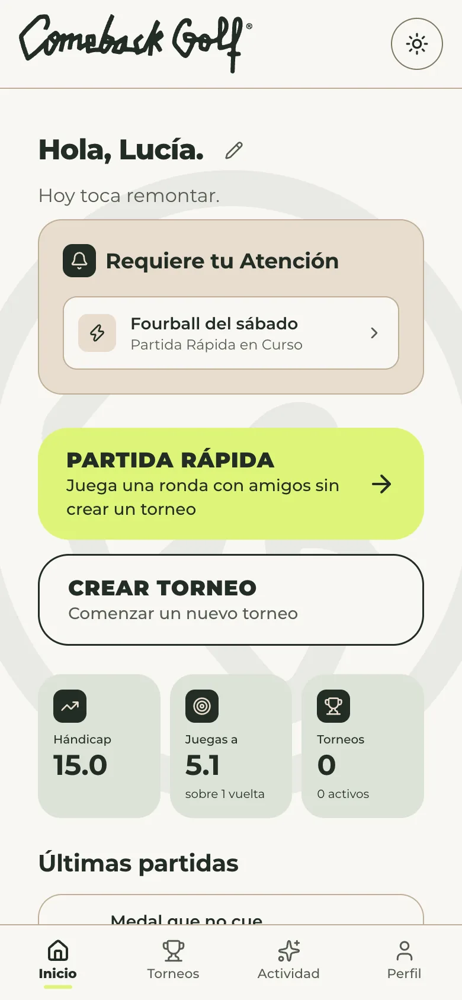
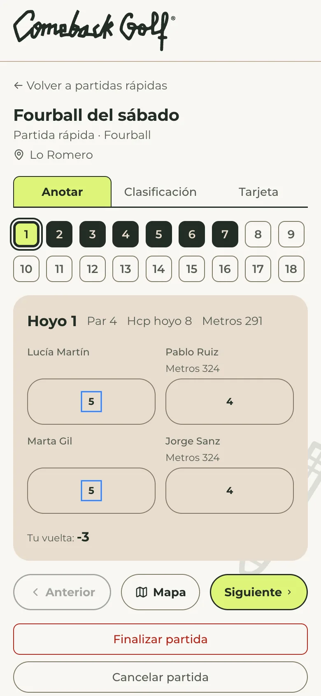
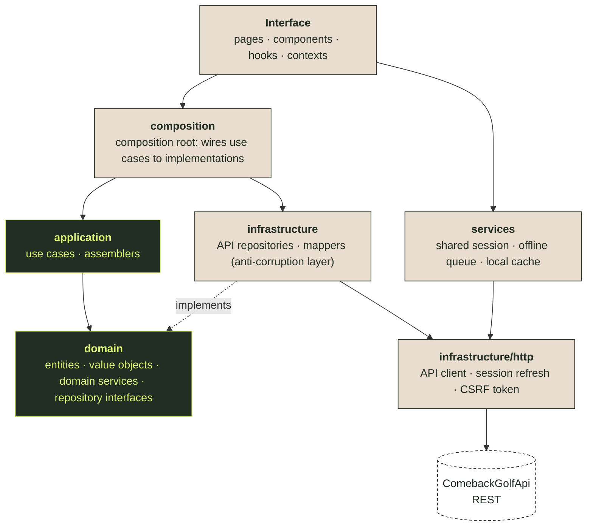

<div align="center">

<a href="https://www.comebackgolf.com">
  <picture>
    <source media="(prefers-color-scheme: dark)" srcset="public/brand/wordmark-acid.svg">
    <source media="(prefers-color-scheme: light)" srcset="public/brand/wordmark-deep.svg">
    
  </picture>
</a>

### Golf among friends

Amateur golf tournaments in a Ryder-style team format, quick rounds with friends<br>
and hole-by-hole scoring that keeps working without coverage.

<a href="https://www.comebackgolf.com"><strong>www.comebackgolf.com</strong></a>
&nbsp;·&nbsp;
<a href="https://github.com/agustinEDev/ComebackGolfApi">Backend API</a>
&nbsp;·&nbsp;
<a href="CHANGELOG.md">Changelog</a>

<br>

[](CHANGELOG.md)
[](https://github.com/agustinEDev/ComebackGolfWeb/actions/workflows/ci-cd.yml)
[](#%EF%B8%8F-quality-and-security)
[](vite.config.js)
[](.github/scripts/bundle_budget.py)

[](https://react.dev)
[](https://vite.dev)
[](https://tailwindcss.com)
[](#-features)
[](LICENSE)

</div>

<br>

<table align="center">
  <tr>
    <td align="center" width="50%">
      <br>
      <sub><b>Home</b>: what needs your attention, at a glance</sub>
    </td>
    <td align="center" width="50%">
      <br>
      <sub><b>Scoring</b>: hole by hole, with the map one tap away</sub>
    </td>
  </tr>
</table>

---

## Contents

- [What it is](#-what-it-is)
- [Features](#-features)
- [Architecture](#%EF%B8%8F-architecture)
- [Tech stack](#-tech-stack)
- [Getting started](#-getting-started)
- [Quality and security](#%EF%B8%8F-quality-and-security)
- [Documentation](#-documentation)
- [License](#-license)

## ⛳ What it is

**Comeback Golf** is a mobile-first web app for groups of amateur golfers who play together. One person
sets up the tournament, the captains build their teams, and everyone scores from their own phone on the
course while the leaderboard updates as the holes come in.

This repository is the **web frontend**: a React single-page app, installable as a PWA, that talks to the
[ComebackGolfApi](https://github.com/agustinEDev/ComebackGolfApi) REST backend. It is available in
**Spanish and English**, with a light and a dark theme.

## ✨ Features

| | Feature | What it does |
|:-:|---|---|
| 🏆 | **Ryder-style tournaments** | Two teams over several rounds of foursomes, fourball and singles, with match play scoring and team points. |
| 📋 | **Stroke play competitions** | Individual competitions scored as Stableford or Medal. |
| ✉️ | **Captains' envelopes and draft room** | Each captain hands in a sealed playing order that is opened only when both are in, and teams can be picked turn by turn in a live draft the whole group can follow. |
| ⚡ | **Quick matches** | A round with friends without creating a tournament: pick the course, the players and who keeps the score. |
| ✍️ | **Hole-by-hole scoring** | Everyone scores from their phone. Without coverage, scores are kept on the device and sent when the connection comes back. |
| 🗺️ | **Hole map** | Satellite view of each hole (Spanish PNOA orthophoto, with newer regional imagery where available) and GPS distances. |
| 🏌️ | **Handicaps** | WHS playing handicaps calculated per format, with official handicap lookup for players federated in Spain. |
| 📊 | **Leaderboards** | Live standings during the round, with public links to share them. |
| 👥 | **Friends and activity** | Friend requests, an activity feed of rounds and tournaments, and the unread count on the app icon. |
| 🗂️ | **Golf courses** | A shared course catalogue with tees and hole data, reviewed by administrators before it goes live. |
| 🔐 | **Accounts** | Email verification, Google sign-in, password reset and a list of signed-in devices that can be revoked remotely. |
| 📱 | **Installable app** | PWA with an offline fallback page, an install prompt and its own icon on the home screen. |

## 🏛️ Architecture

The code follows **Clean Architecture** with **Domain-Driven Design**. The layers are not just a convention:
the contracts in [`.dependency-cruiser.cjs`](.dependency-cruiser.cjs) are checked on every push by the
`Architecture` job, and a forbidden import fails it.



Main rules (the full set is in [`.dependency-cruiser.cjs`](.dependency-cruiser.cjs)):

| Rule checked in CI | Meaning |
|---|---|
| `domain-is-pure` | The domain depends on nothing else in `src/`, nor on React. |
| `application-only-uses-domain` | Use cases depend only on the domain (and `utils`). |
| `infrastructure-does-not-reach-up` | Infrastructure implements the domain repositories and never imports use cases or the composition root. |
| `ui-goes-through-composition` | Pages, components and hooks reach use cases only through `src/composition`. |
| `core-only-reaches-allowed-packages` | Domain and use cases may only import an allow-listed set of npm packages (today, `uuid`). |
| `no-circular` | No circular dependencies between modules. |

The JavaScript core (`domain`, `application`, `infrastructure`) is type-checked with `checkJs` against its
JSDoc (`npm run typecheck:nucleo`). The decisions behind the design are in the
[ADRs](docs/architecture/decisions/).

## 🧰 Tech stack

| Area | Tools |
|---|---|
| **UI** | React 19 · React Router 8 · Tailwind CSS 4 · Framer Motion · Lucide icons |
| **Build** | Vite 8 · `vite-plugin-pwa` (Workbox) · `vite-plugin-sri3` (Subresource Integrity) |
| **Maps** | MapLibre GL |
| **Drag and drop** | dnd-kit |
| **i18n** | i18next + react-i18next, 19 namespaces in Spanish and English |
| **Monitoring** | Sentry: errors, traces and replays of sessions with an error, with all text masked |
| **Tests** | Vitest + Testing Library + jsdom · Playwright for end-to-end |
| **Code quality** | ESLint 9 · Prettier · TypeScript 7 (`checkJs`) · dependency-cruiser |

## 🚀 Getting started

**Requirements:** Node.js 22 (see [`.nvmrc`](.nvmrc)) and, for anything beyond the public pages, a running
[ComebackGolfApi](https://github.com/agustinEDev/ComebackGolfApi).

```bash
git clone https://github.com/agustinEDev/ComebackGolfWeb.git
cd ComebackGolfWeb
npm ci
cp .env.example .env      # VITE_API_BASE_URL=http://localhost:8000 by default;
                          # empty VITE_SENTRY_DSN and the TEST_* values unless you use them
npm run dev               # http://localhost:5173
```

| Command | What it does |
|---|---|
| `npm run dev` | Development server with hot reload |
| `npm run build` · `npm run preview` | Production build in `dist/`, and a local preview of it |
| `npm test` | Vitest in watch mode; `npm test -- --run --coverage` runs it once with coverage, as CI does |
| `npm run test:e2e:smoke` | Playwright tests tagged `@smoke`, which need no backend |
| `npm run test:e2e` | Every Playwright test (some need the backend and a test user) |
| `npm run lint` · `npm run format:check` | ESLint with zero warnings allowed, and Prettier |
| `npm run lint:architecture` | Clean Architecture contracts (dependency-cruiser) |
| `npm run typecheck:nucleo` | Type check of the JavaScript core |

Main environment variables (all of them are listed in [`.env.example`](.env.example)):

| Variable | Purpose |
|---|---|
| `VITE_API_BASE_URL` | Backend URL |
| `VITE_GOOGLE_CLIENT_ID` · `VITE_GOOGLE_REDIRECT_URI` | Google sign-in |
| `VITE_SENTRY_DSN` · `VITE_SENTRY_ENVIRONMENT` · `VITE_SENTRY_TRACES_SAMPLE_RATE` · `VITE_SENTRY_REPLAYS_SESSION_SAMPLE_RATE` · `VITE_SENTRY_REPLAYS_ON_ERROR_SAMPLE_RATE` | Sentry; without a DSN it is not started (the `.env.example` placeholder is not empty: clear it) |

The full local setup, backend included, is in [SETUP.md](SETUP.md).

## 🛡️ Quality and security

Every push to `main`, `develop`, `feature/**`, `release/**` or `hotfix/**`, and every pull request to `develop` or `main`, runs the
[CI/CD pipeline](.github/workflows/ci-cd.yml) in two columns: static analysis and security first, then tests and builds, which only run if the first column passes. Each job
leaves a summary card saying what it checked. Details in
[`.github/workflows/README.md`](.github/workflows/README.md).

<table>
<tr>
<td valign="top" width="50%">

**Code**

- 🧪 **15,257 Vitest tests**, with coverage gates of 90% lines, 89.5% statements and 86.5% functions and branches
- 🎭 Playwright smoke tests in Chromium
- 🔍 ESLint (zero warnings) and Prettier
- 📝 TypeScript checks, including `checkJs` on the core
- 🏛️ Architecture contracts (dependency-cruiser)
- 📦 Startup JS budget: ≤ 280 KB gzip, ≤ 320 KB per chunk
- 🚀 A second build that repeats Render's (its Node, its npm, `npm install`) and serves the result as a static site

</td>
<td valign="top" width="50%">

**Security**

- 🛡️ Semgrep with the OWASP Top 10, React and JavaScript rules; CodeQL on GitHub
- 🔐 Secret scanning with TruffleHog and gitleaks over the whole history
- 🔒 `npm audit`, licence allow-list and Dependency Review on pull requests
- 🐍 Snyk review every week and on every pull request to `main`
- 🔏 Every commit signed and verified by GitHub
- 📌 Third-party actions pinned by commit SHA; Dependabot waits 5 days (3 for Docker images) before proposing a new version
- 🌐 Production headers (CSP with no inline scripts, HSTS, COOP, CORP) compared every day with [the expected set](.github/scripts/cabeceras_de_produccion.json)

</td>
</tr>
</table>

In the app itself: the session lives in **httpOnly cookies** with a CSRF token, the built assets carry
**Subresource Integrity**, the CSP allows no inline scripts, Google sign-in uses **PKCE**, and Sentry masks
all text in replays and scrubs tokens from URLs. How the headers are set up in production is in
[docs/SECURITY_HEADERS.md](docs/SECURITY_HEADERS.md). To report a vulnerability, use the contact in
[`security.txt`](public/.well-known/security.txt).

## 📚 Documentation

| Document | Contents |
|---|---|
| [SETUP.md](SETUP.md) | Local development with backend and frontend |
| [CHANGELOG.md](CHANGELOG.md) | Every release, in detail |
| [docs/architecture/decisions](docs/architecture/decisions/) | Architecture Decision Records |
| [.github/workflows/README.md](.github/workflows/README.md) | What each CI job checks |
| [docs/BRANCH_PROTECTION.md](docs/BRANCH_PROTECTION.md) | GitFlow, protected branches and release tags |
| [docs/SECURITY_HEADERS.md](docs/SECURITY_HEADERS.md) | Production security headers (in Spanish) |
| [docs/RENDER_SETUP.md](docs/RENDER_SETUP.md) | Sentry variables on Render |
| [docs/INTEGRATION_TESTS.md](docs/INTEGRATION_TESTS.md) | Playwright tests against a real backend |
| [ROADMAP.md](ROADMAP.md) | Planning history of the 2.0 series |

Kept for reference only, with their date: the [July 2026 audit](docs/AUDIT_FRONTEND_2026-07.md), the
[first Sentry setup](docs/SENTRY_IMPLEMENTATION_SUMMARY.md) (November 2025) and the
[project presentation](docs/presentation.md) (February 2026).

**Conventions:** GitFlow (`feature/*`, `fix/*` and `docs/*` into `develop`; `release/vX.Y.Z` and `hotfix/*` into `main`, then merged back into `develop`), signed
commits, and [Conventional Commits](https://www.conventionalcommits.org/). Commit subjects are written in
uppercase; pull request titles are checked in CI as `type(scope): Subject`, with a lowercase type.

## 📄 License

Copyright © 2025-2026 Agustín Estévez Domínguez. **All rights reserved.**

The source code is published **for viewing only**: no licence is granted to use, copy, modify or distribute it
without the author's written permission. Versions published before 20 October 2026 in the predecessor
repository remain under the MIT License. Third-party components keep their own licences. See [LICENSE](LICENSE).

<div align="center">
<br>
<sub>Golf among friends · <a href="mailto:hola@comebackgolf.com">hola@comebackgolf.com</a></sub>
</div>
