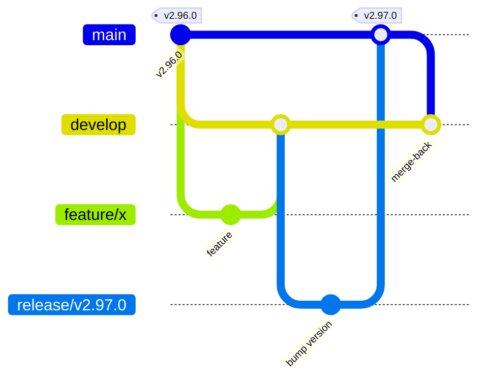

# GitFlow and branch protection

How branches, releases and their protections work in this repository. The protection settings below are the
ones configured on GitHub (Settings → Branches and Settings → Rules), checked on 28 Nov 2026.

## GitFlow



| Branch | Comes from | Goes to |
|---|---|---|
| `develop` | | Default branch: integration of the next release |
| `feature/*`, `fix/*`, `docs/*`... | `develop` | PR to `develop` |
| `release/vX.Y.Z` | `develop` | PR to `main`, then merged back into `develop` |
| `hotfix/*` | `main` | PR to `main`, then merged back into `develop` |
| `main` | | Production: moving it deploys the site |

After every release or hotfix, `develop` must contain everything in `main`:

```bash
git fetch origin
git rev-list --count origin/develop..origin/main   # must be 0
```

## Protection of `main` and `develop`

| Setting | Value |
|---|---|
| Pull request required | Yes, with 0 approvals (single maintainer) |
| Signed commits required | Yes |
| Rules apply to administrators | Yes |
| Branch must be up to date before merging | `main`: Yes · `develop`: No |
| Force pushes | Not allowed |
| Deletion | Not allowed |
| Linear history | Not required |
| Conversation resolution | Not required |

### Required status checks

| Check | Workflow | `main` | `develop` |
|---|---|:-:|:-:|
| 🔏 Signed commits | `ci-cd.yml` | ✅ | ✅ |
| 🔒 npm audit | `ci-cd.yml` | ✅ | ✅ |
| 🔐 Secret Scanning | `ci-cd.yml` | ✅ | ✅ |
| 📜 License Compliance | `ci-cd.yml` | ✅ | ✅ |
| 🔎 Dependency Review | `ci-cd.yml` | ✅ | ✅ |
| 📦 Outdated deps | `ci-cd.yml` | ✅ | ✅ |
| 🛡️ OWASP (Semgrep) | `ci-cd.yml` | ✅ | ✅ |
| 🔍 Lint | `ci-cd.yml` | ✅ | ✅ |
| 📝 Type Check | `ci-cd.yml` | ✅ | ✅ |
| 🏛️ Architecture | `ci-cd.yml` | ✅ | ✅ |
| 🧪 Tests + coverage | `ci-cd.yml` | ✅ | ✅ |
| 🏗️ Build | `ci-cd.yml` | ✅ | ✅ |
| 🚀 Deploy like Render | `ci-cd.yml` | ✅ | ✅ |
| 📝 Conventional Commits Check | `pr-checks.yml` | ✅ | |
| CodeQL | GitHub default setup | ✅ | ✅ |

🎭 **E2E smoke** runs on every push and PR but is not a required check. Snyk (`snyk-review.yml`) runs on PRs to
`main` and is not required either: its result is reviewed before merging. What each check does is in
[`.github/workflows/README.md`](../.github/workflows/README.md).

## Release tags

A repository ruleset (**Release tags**) protects every tag matching `v*`: it cannot be deleted, moved or
force-updated, and must be signed. Because a published tag cannot be fixed, create it **only after the
release PR is merged into `main`**, on that merge commit:

```bash
git switch main && git pull
git tag -s vX.Y.Z -m "vX.Y.Z"
git push origin vX.Y.Z
```

## Release checklist

- [ ] `release/vX.Y.Z` branched from an up-to-date `develop`
- [ ] Version bumped in `package.json` and `package-lock.json`, and the release written in `CHANGELOG.md`
- [ ] All required checks green on the PR to `main`
- [ ] After the merge: signed tag on the merge commit, then merge `main` back into `develop`
- [ ] `git rev-list --count origin/develop..origin/main` is 0

If the release changes the API contract, the backend release goes out first.

## Repository security settings

- **Dependabot** alerts and version updates (weekly, against `develop`).
- **Code scanning** with CodeQL (default setup) and Semgrep (SARIF uploaded by `ci-cd.yml`).
- **Secret scanning**: GitHub secret scanning with push protection, plus TruffleHog and gitleaks in the pipeline.

## References

- [A successful Git branching model](https://nvie.com/posts/a-successful-git-branching-model/)
- [About protected branches](https://docs.github.com/en/repositories/configuring-branches-and-merges-in-your-repository/managing-protected-branches/about-protected-branches)
- [About rulesets](https://docs.github.com/en/repositories/configuring-branches-and-merges-in-your-repository/managing-rulesets/about-rulesets)
- [Conventional Commits](https://www.conventionalcommits.org/)
- [Semantic Versioning](https://semver.org/)
